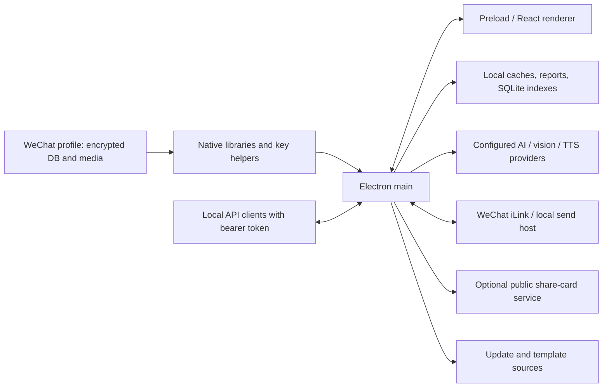

# Результаты статического аудита

База и границы исследования: [индекс аудита](README.md). Severity ниже — оценка риска при указанных условиях, без утверждения о состоявшейся эксплуатации. «Подтверждено» относится к поведению кода; «не установлено» — к фактической эксплуатации или содержимому закрытого компонента.

## Карта доверия и обработки данных

`src/main/index.ts` связывает Electron lifecycle, IPC, БД, AI, автоматизацию и HTTP API. `src/preload/index.ts` экспортирует renderer мост. `src/renderer/src` содержит React-интерфейс, клиентские запросы и генерацию AI-контекста; `src/shared` — DTO, коды и схемы. Electron Vite собирает main, preload, renderer и worker entry points ([конфигурация](../../electron.vite.config.ts)). Worker-процессы обслуживают knowledge index и offline speech recognition.

Ключи БД поступают из UI/clipboard или native helper, нормализуются как 64 hex-символа и передаются в WCDB. БД и image key stores используют `safeStorage`, файлы с `0600`, отказ при недоступности encryption ([DB](../../src/main/database-key-store.ts), [images](../../src/main/image-key-store.ts)). AI и Fish Audio ключи используют [AIProviderKeyStore](../../src/main/ai-provider-key-store.ts); share-service upload token — [отдельный encrypted store](../../src/main/wechat-share-config-store.ts). Это положительные меры, но данные в памяти и доступ авторизованного renderer не защищаются шифрованием файла.

Расшифрованные сообщения, результаты OCR/транскрипции, отчёты и Agent Hub диалоги сохраняются локально. [KnowledgeStore](../../src/main/knowledge/knowledge-store.ts) использует обычный `node:sqlite`, [bootstrap-cache](../../src/main/services/bootstrap-cache.ts) — JSON, [conversation store](../../src/main/services/agent-hub-conversation-store.ts) и [inbox](../../src/main/services/wechat-inbound-inbox.ts) — локальные JSON. Наличие шифрования исходной WeChat БД **не означает** шифрования производных копий. Это свойство хранения, а не обнаруженная внешняя утечка; нужны disk encryption, политика очистки и исключения для backup.

## S-01. Непроверенный native-компонент содержит cloud-report endpoints

**Риск: высокий, требуется дополнительная проверка; P0 для допуска к реальным данным.**

В `resources/libwcdb_api.dylib` (arm64, SHA-256 `3c781e10a8616db622ff8a9d5347000dd6ef2f385eabae1aea244965e6a15422`) статически обнаружены NUL-terminated ASCII строки:

- offset `926214`: `https://api.weflow.top/api/report`;
- offset `926248`: `https://api.weflow.top/api/token`;
- символ `_wcdb_cloud_report` и C++ thread symbols с этим именем.

Это подтверждает присутствие сетевых адресов и связанной символики в артефакте. Не установлены вызывающий путь, метод запроса, отправляемые поля, автоматичность, связь с `InitProtection` или факт утечки. TypeScript не содержит прямого вызова `wcdb_cloud_report`. Слова `report`/`token` сами по себе не доказывают передачу чатов или ключей.

[Wcdb4Client.resolveNativeLibrary](../../src/main/wcdb4-client.ts#L3443) сначала ищет архитектурный `resources/wcdb/macos/arm64/libwcdb_api.dylib`, затем x64/общие/fallback пути, включая корневую библиотеку; допускает `WCDB_DLL_PATH`. Следовательно, подозрительный файл не является первым выбором при полном стандартном комплекте. Однако [mac packaging](../../electron-builder.yml) копирует `resources` с широким фильтром, и fallback остаётся достижимым при неполном комплекте/override. Инициализация библиотеки вызывает `InitProtection` и `wcdb_init`; их внутреннее поведение не видно в TS.

Исправление следующего этапа: получить соответствующие исходники и лицензию, установить caller/payload статическим разбором, воспроизвести сборку; исключить непроверенные fallback-компоненты из дистрибутива отдельным PR. До этого не загружать native-библиотеки с реальными данными и не объявлять приложение полностью offline. Динамическую проверку разрешать отдельно, только с синтетической БД и запрещённым внешним egress. В этом аудите бинарник не запускался.

## S-02. International-сборка наследует upstream identity и обновления

**Риск: высокий для собственного дистрибутива; P0 перед выпуском.**

[build/app-update.yml](../../build/app-update.yml) указывает `Wxw-Gu/TraceMemo`; оба [builder config](../../electron-builder.yml) и [Windows config](../../electron-builder.win.yml) публикуют туда же и используют `com.tracememo.app`. [APP_UPDATE_RELEASES_URL](../../src/shared/app-update.ts) тоже ведёт в upstream. Это корректная конфигурация оригинала, но неверная граница доверия для International-форка.

[AppUpdateService](../../src/main/services/app-update-service.ts#L140) планирует packaged startup check через 1500 ms. `autoDownload=false`: загрузка не происходит просто от проверки. Windows использует automatic delivery, установка возможна после загрузки; `autoInstallOnAppQuit` включён для automatic delivery. macOS auto-install намеренно выключен и отправляет на release page; сам check при этом возможен. `notarize:false` в builder, mac entitlements разрешают JIT/unsigned executable memory/DYLD environment. Это не доказательство обхода подписи updater, но подписанные International-обновления здесь не подтверждены.

До собственной сборки нужны отдельные appId, подписи, updater feed, namespace профиля, release channel и publish target. Отдельно проверить сохранение/миграцию данных; не использовать upstream signing keys и не запускать `release:*` с текущими настройками.

## S-03. Метаданные при обновлениях: постоянный staging UUID

**Риск для приватности: низкий–средний; подтверждено по pinned dependency, сетевой запуск не выполнялся.**

Manifest задаёт range `^6.6.2`, а lockfile фиксирует **`electron-updater@6.8.9`**. Прочитан установленный код именно разрешённой версии: `out/AppUpdater.js`, `getOrCreateStagingUserId` (около строки 501) создаёт random UUID, сохраняет `.updaterId`; `getUpdateInfoAndProvider` (около 379) добавляет `x-user-staging-id`. `out/providers/Provider.js:createRequestOptions` объединяет эти headers, а `GitHubProvider.getLatestVersion` делает metadata requests. [Hashes просмотренных dependency-файлов](evidence/inspected-dependency-files.csv) сохранены. Это библиотечный идентификатор rollout, который может коррелировать проверки одной установки. В app-коде отключения этого поведения не найдено.

Не найдена передача переписки/ключей в updater. Нельзя писать «никакие идентификаторы не отправляются»: обычные IP/HTTP metadata и staging UUID существуют. Нужны политика opt-in/отключения checks, понятное описание metadata и mock transport тест на headers следующего этапа. Наличие UUID не означает отслеживание содержимого переписки автором проекта.

## S-04. iLink credentials хранятся без шифрования

**Риск: средний при локальном чтении/backup; P1.**

[account-store.ts](../../src/main/services/wechat-ilink/account-store.ts#L104) сохраняет объект credentials, включая `bot_token`, обычным `JSON.stringify`; `.context.json` содержит `context_token`. Есть атомарная запись, `0600` для файлов и `0700` для новых директорий, но нет `safeStorage`. Windows mode bits не заменяют проверку ACL. Legacy `.wechatexplorer` читается как fallback, поэтому миграция должна учитывать обе директории и удаление старых секретов только после проверки.

Это не передача DB key наружу. При чтении профиля сторонним процессом/backup возможен захват bot session. Следующий PR: encrypted store и миграция с fail-closed, очистка и ACL-тесты. Также проверить имена account ID: `normalizeAccountId` заменяет `@ . :`, но не задаёт строгий allowlist для разделителей пути; удалённая эксплуатация не установлена, так как ID поступает из доверенного login response.

## S-05. Широкий IPC без общей проверки origin/sender

**Риск: высокий при компрометации renderer; P1. Самостоятельный XSS/RCE этим аудитом не доказан.**

[createWindow](../../src/main/index.ts#L798) явно задаёт `sandbox:false`, остальные `contextIsolation`/`nodeIntegration` опираются на defaults Electron. [preload](../../src/preload/index.ts) экспортирует как предметный `api`, так и `electronAPI`. В установленном `@electron-toolkit/preload@3.0.2/dist/index.cjs` есть generic `ipcRenderer.invoke/send/on` с произвольным channel. Большинство обработчиков в `index.ts` и [report-template-ipc](../../src/main/report-template-ipc.ts) не проверяет `event.senderFrame`, URL и принадлежность главному окну. TypeScript-типы входных DTO не являются runtime validation.

Доступные операции включают сохранение/получение DB keys, reveal/copy API token, file selection/export, provider config, native key acquisition и отправку сообщений. Это предполагает доверенный renderer; при его компрометации ущерб велик. Наличие contextBridge само по себе не даёт capability isolation.

Отдельный риск: [setWindowOpenHandler](../../src/main/index.ts#L867) передаёт `details.url` в `shell.openExternal` без allowlist scheme; [RichMessageBubble](../../src/renderer/src/components/RichMessageBubble.tsx) открывает ссылки из сообщений. Нужны разрешённые `https:`/`http:` по продуктовой политике, обработка custom/file schemes и контроль `will-navigate`. Не утверждается, что одно открытие ссылки уже даёт исполнение кода.

Исправлять отдельным PR: allowlist typed bridge, общий main-frame sender guard и схемы параметров; явные secure webPreferences; убрать generic bridge; проверить navigation. Текущий PR поведение не меняет.

## S-06. Политика согласия AI не унифицирована в main

**Риск: высокий для конфиденциальности при remote provider; P1.**

У legacy [AiSearchPipelineService](../../src/main/services/ai-search-pipeline-service.ts) есть request-bound authorization, привязанная к provider и recipient. UI [ensureAiSearchDataConsent](../../src/renderer/src/components/search/services/aiSearchProviderConsent.ts) получает подтверждение; [AISearchWorkspace](../../src/renderer/src/components/search/AISearchWorkspace.tsx#L401) вызывает этот guard. Это полезная защита.

Но [ask-wechat:query](../../src/main/index.ts#L2308) передаёт запрос напрямую в `AskWechatService`, далее [QueryAgentService](../../src/main/services/query-agent-service.ts#L1339) вызывает `chatWithTools`; общего main-side gate, потребляющего то же authorization, там нет. `ai:chat`, отчёты ([useGroupReportGeneration](../../src/renderer/src/hooks/useGroupReportGeneration.ts)), image insight, TTS и Agent Hub используют другие пути. Подтверждено различие enforcement; это не утверждение, что штатный desktop UI всегда обходит своё окно согласия.

Query Agent передаёт вопрос, историю, tool schema и результаты чтения выбранных сообщений/OCR/транскрипции; отчёты — выбранные сообщения и имена; image insight — расшифрованную картинку и metadata; TTS — текст. Настройка AI провайдера не равнозначна согласию на каждый тип этих данных. Не применять обещание legacy «максимум 8 источников» ко всем AI путям.

Следующий PR: единый policy service в main, authorization на operation/request/provider origin/data categories, отмена при смене адресата, scope и бюджеты данных. Отдельные согласия для автоматических задач. Не локализовать DB/IPC/protocol identifiers ради i18n.

## S-07. Agent Hub: не видна локальная привязка права чтения к отправителю

**Риск: потенциально высокий при доставке сообщений посторонним; внешняя достижимость требует проверки.**

[handleInboundMessages](../../src/main/services/agent-hub-service.ts#L553) принимает сообщения из connector, сохраняет их; `processInboxEntry` маршрутизирует запрос и отправляет ответ в `entry.fromUserId`. `recent_list` возвращает локальные контакты; `handleKnowledgeQuery` обращается к общему Query Agent. В просмотренных connector/poller/message normalization и service нет локального allowlist владельца или разрешённых conversation scopes для inbound sender.

Не установлено, допускает ли сам Tencent iLink доставку от произвольного третьего лица: сервер может ограничивать owner pairing. Поэтому это **разрыв локальной авторизации**, а не подтверждённое удалённое раскрытие любой переписки. До допуска feature к реальным данным документировать серверную гарантию и добавить локальное owner binding, запрет по умолчанию, scopes и тест чужого sender. Наличие корректного bot token удостоверяет приложение перед сервером, но не автоматически права отправителя читать локальные чаты.

## S-08. Локальный API: защищён токеном, но может выйти за loopback

**Риск: средний при изменении bind address; P1.**

[DEFAULT_SETTINGS](../../src/main/services/settings-store.ts#L122) задаёт **`apiEnabled:true`**, `127.0.0.1:6131`. [Инициализация](../../src/main/index.ts#L3187) пытается создать token и запустить API. Не следует повторять неверное предположение из раннего onboarding, что API по умолчанию выключен: отсутствие listener в конкретном Linux запуске не определяет default; `ApiTokenStore` блокирует работу при недоступном secure storage.

Положительные меры [http-server](../../src/main/http-server.ts): 32 random bytes bearer token, timing-safe digest comparison, health-only auth exemption, CORS только HTTP loopback origins, body limit 1 MiB, method allowlist, `no-store`; image endpoints используют message references, не произвольный путь. `sanitizeChatlogMessage` удаляет `contentData.aeskey`. Тесты подтверждали эти сценарии на mocks.

Но `startHttpServer(host,port)`, `api:start`, settings допускают произвольный bind address; транспорт — HTTP. CORS не защищает от non-browser clients, а bearer открывает и чтение, и write/send capabilities без отдельных scopes. При ручном выставлении `0.0.0.0` секрет и содержимое могут идти по сети открытым текстом. Это не auth bypass при штатном loopback. Рекомендация: loopback-only default enforcement, отдельное осознанное включение remote TLS, scoped tokens и rate/resource budgets.

## S-09. Динамические URL без единой egress-политики

**Риск: средний; P1, зависит от источника URL.**

[AIProviderService](../../src/main/services/ai-provider-service.ts#L700) не ограничивает baseUrl HTTPS (HTTP нужен для Ollama); fetch передаёт ключ, custom headers и контекст выбранному адресату. [iLink setBaseUrl](../../src/main/services/wechat-ilink/client.ts#L104) принимает HTTP/HTTPS из login/redirect responses; media upload использует server-provided `upload_full_url`. [StickerService](../../src/main/sticker-service.ts#L122), avatar embedding/export скачивают URL из данных, в том числе HTTP и redirects. Лимиты размера ответа неодинаковы. Это позволяет обращения к нежелательным/локальным адресам при контроле URL и создаёт SSRF/privacy/DoS поверхность; конкретная удалённая атака не демонстрировалась.

Рекомендации: HTTPS для удалённых AI, запрет credential-bearing redirects/downgrade, отдельное разрешение local provider, проверка каждого redirect/DNS result, ограничения времени/размера, явная политика внешних изображений. Не добавлять wildcard egress ради «полноты» списка. Подробные источники и payload — [inventory](network-inventory.md).

## S-10. Публичные share cards и неполная граница хранения

**Риск: средний при использовании optional feature; подтверждённое свойство продукта.**

[WechatShareCardService](../../src/main/wechat-share-card-service.ts) по publish передаёт title, description, полный report PNG и thumbnail заданному сервису. [Worker](../../services/share-card-worker/src/index.js) защищает upload bearer token, но выдаёт страницы и изображения по UUID без viewer authentication; срок 1–30 дней, удаление при чтении истёкшего card. Заголовок `private` cache-control не является проверкой личности. Ссылку может просмотреть любой получатель/переславший; загруженный SDK Tencent исполняется на share-page origin. Это не скрытая автоматическая выгрузка всех чатов.

Нужно явно объяснять публикацию содержимого отчёта, поддержать revoke/access policy и уборку независимо от посещений. Учесть Cloudflare R2, логи сервиса, backups и действительную retention. Worker сначала парсит JSON/base64, затем проверяет размер decoded images: требуется bounded request body для DoS защиты.

## S-11. Supply chain, права на сборки и производные plaintext копии

Подробности: [supply chain и лицензии](supply-chain-and-license.md). Есть непроверенные native-компоненты с доступом к ключам и памятью WeChat, postinstall загружает внешние артефакты; версии npm с integrity не покрывают отдельно скачиваемые исполняемые файлы. `safeStorage.isEncryptionAvailable` не проверяет конкретный Linux backend `basic_text`; Linux не является заявленной платформой native WeChat, но расширять поддержку без проверки backend нельзя.

`VITE_DB_KEY` защищён `import.meta.env.DEV` в renderer; поэтому не заявляется его безусловная утечка в production. Для `VITE_IMAGE_AES_KEY` в [ImageKeyConfigService](../../src/main/services/image-key-config-service.ts#L58) аналогичного DEV-guard нет. Изученный generated main содержит build-time substitution пустой строки (текущая конфигурация без реальных ключей). Подстановка непустого image key при иной сборке — риск contamination, требующий отдельного synthetic-marker build-теста; после ограничения на static-only этот тест не выполнялся. Secret `.env` может попасть в bundle через substitution даже при исключении самого `.env` из packaging. Не использовать реальные ключи ни в build environment, ни в release CI.

## Телеметрия и вывод об утечках

По first-party TS/JS не обнаружен независимый Sentry/PostHog/Mixpanel/crash-upload контур или скрытая отправка DB key в фиксированный внешний endpoint. `analytics` в отчётах — статистика чата, а `@opentelemetry/api` в lockfile — peer metadata; это не доказательство telemetry exporter. iLink намеренно отправляет `base_info.bot_agent`, `channel_version`, lifecycle notifications и protocol headers. Updater UUID и неизвестный cloud-report код native-библиотеки исключают категорический вывод «телеметрии нет».

Передача сообщений в AI и публикация отчётов существуют как функции и описаны выше. Подтверждённой скрытой выгрузки переписки или DB keys аудит не установил. Отсутствие такого подтверждения не оправдывает запуск непросмотренных native libraries с реальными данными.

## Что проверить отдельно

1. Исходники и статические callers/payload native `wcdb_cloud_report`; подписи и reproducibility всех 19 компонентов, особенно privileged helpers.
2. Полный outbound trace на macOS/Windows только после отдельного разрешения и с синтетическими профилями; запрет внешнего egress, mock AI/iLink endpoints.
3. Owner-scoping iLink на стороне Tencent и локальные ACL Agent Hub; negative tests постороннего sender и prompt injection в найденных сообщениях.
4. Достижимость каждого advisory, итоговый ASAR/installer SBOM и signature validation; старый успешный build этого не доказывает.
5. Реальный secure-storage backend, filesystem ACL, backup/retention и legacy migration на каждой ОС.
6. Недоверенный ZIP, renderer navigation и malicious remote media — отдельные bounded negative tests; отсутствие готового exploit в этом отчёте не является оправданием оставлять поверхность открытой.
